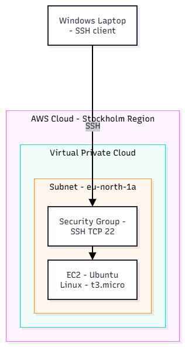
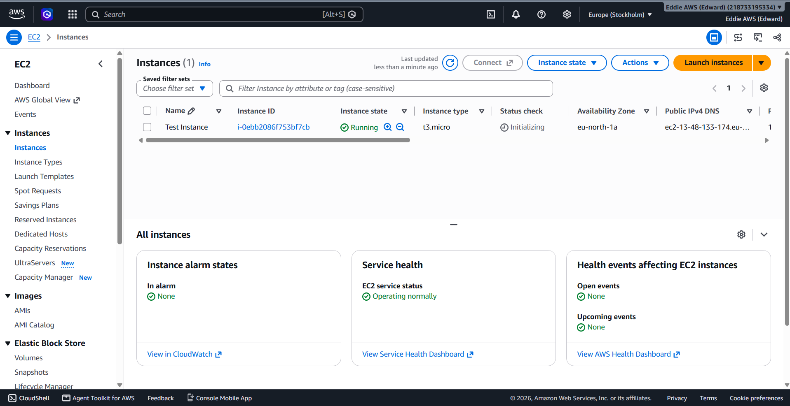
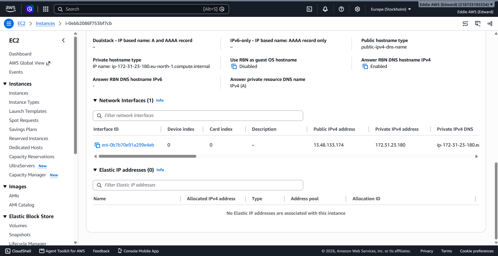

# AWS EC2 Virtual Server Deployment

## Project Overview

This project demonstrates how to deploy and configure a basic Linux virtual server using Amazon EC2.

The goal was to understand how EC2 instances work, how network access is controlled, and how to connect securely to a cloud-based server.

## Technologies Used

- Amazon EC2
- Amazon VPC
- AWS Security Groups
- Amazon EBS
- Amazon Linux

## Configuration

**1. EC2 Instance**

I launched an EC2 instance using Amazon Linux and selected a small instance type suitable for testing.

**2. Networking**

I deployed the instance inside a VPC and public subnet with appropriate internet routing.

**3. Security**

I configured a security group to allow SSH connections on port 22 from my own public IP address only.

**4. Storage**

I used an EBS root volume to store the operating system and files required by the instance.

## Testing

After launching the instance, I verified that its status was running and that the status checks passed.

I then connected to the instance and ran a Linux command to confirm that the virtual server was accessible.

## What I Learned

This project helped me understand how virtual servers are deployed in AWS, how security groups control network access, and how different infrastructure components work together.

## Architecture Diagram

## Screenshots

### 1. EC2 Instance Overview
The Ubuntu EC2 instance running in the Stockholm region.

### 2. Security Group Configuration
Inbound SSH access restricted to a specific IP address.

.png)

### 3. Network Configuration
The VPC, subnet, and IP configuration of the instance.

### 4. SSH Connection
Successfully connected to the Ubuntu server using SSH.

## What I Learned

Through this project, I gained practical experience deploying and accessing an Ubuntu Linux virtual server using Amazon EC2.

**SSH Key Pair Authentication**

I learned how SSH key pairs work and how a private key can be used to authenticate a connection to an EC2 instance. This helped me better understand secure remote access and the importance of protecting private keys.

**EC2 Networking**

I explored how an EC2 instance operates within a VPC and subnet, and learned the difference between public and private IPv4 addresses.

I also configured a security group to allow inbound SSH traffic on TCP port 22 from a specific IP address, rather than permitting unrestricted access.

**Testing and Verification**

I successfully connected to my Ubuntu instance using SSH and executed the `uname -a` command to verify the operating system and kernel information.

This project helped me understand how cloud infrastructure, networking, and access controls work together to make a virtual server accessible.
