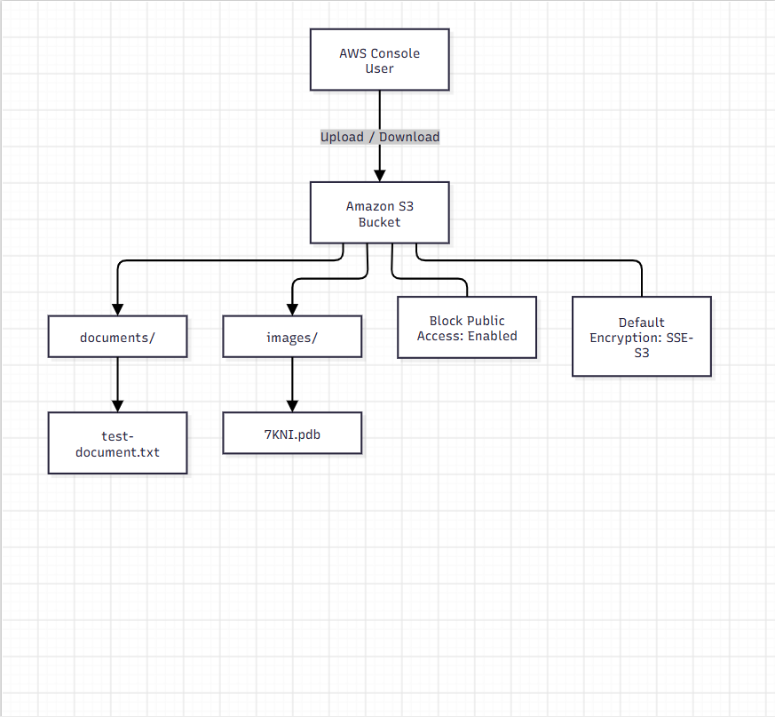
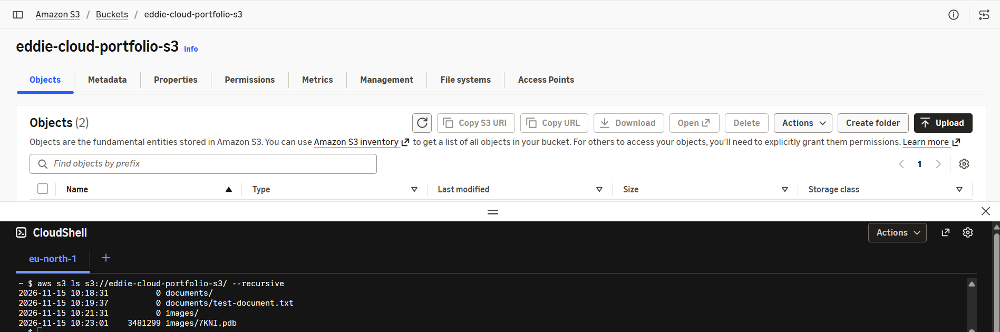
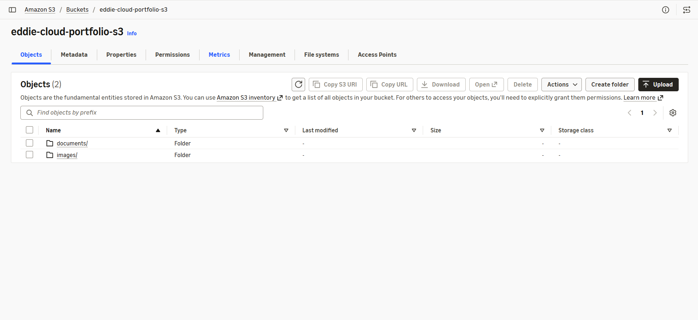
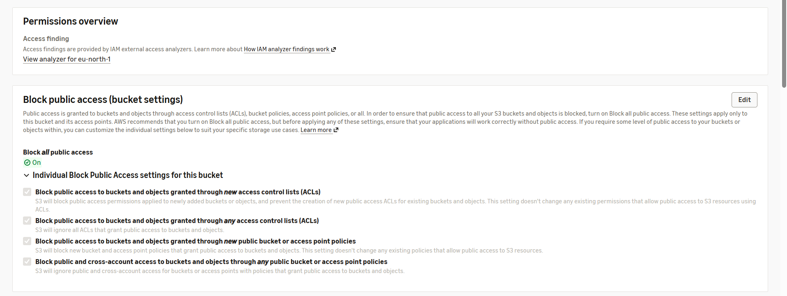

# Amazon S3 Bucket Management

## Project Overview

This project demonstrates the creation and basic management of an Amazon S3 bucket using the AWS Management Console.

The objective was to gain hands-on experience with cloud object storage, organizing uploaded files, and understanding the security settings used to protect stored data.

## AWS Services Used

- Amazon Simple Storage Service (S3)

## Configuration

- Created a general-purpose S3 bucket.
- Kept Block Public Access enabled.
- Used SSE-S3 encryption for stored objects.
- Organized test files using folder-like prefixes.
- Uploaded and downloaded objects to verify storage functionality.

## Architecture Diagram

## Screenshots

### 1. Bucket Overview

### 2. Uploaded Objects

### 3. Bucket Permissions

## What I Learned

This project helped me understand how Amazon S3 stores objects within buckets, how object keys can be used to organize files, and how bucket-level security settings help protect data from unauthorized public access.

I also gained experience uploading, retrieving, and managing objects using the AWS Management Console.
