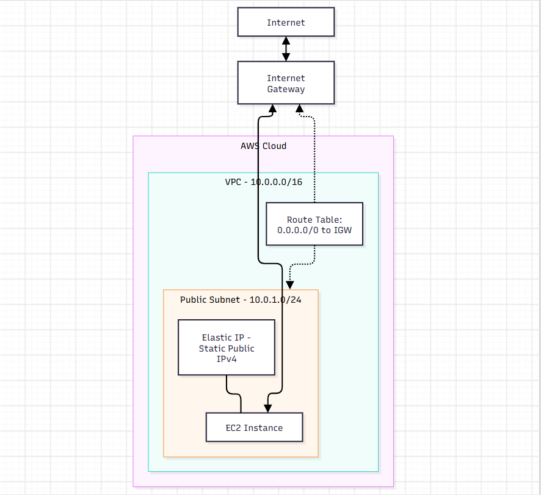

# AWS VPC Networking & Elastic IP Configuration

## Project Overview

This project explores the fundamentals of cloud networking using Amazon Virtual Private Cloud (VPC) and Amazon EC2.

The objective was to understand how EC2 instances operate within VPC subnets, how network configurations determine connectivity, and how Elastic IP addresses provide static public IPv4 addresses for cloud resources.

## AWS Services and Technologies Used

- **Amazon VPC** — Creating and managing isolated virtual networks.
- **VPC Subnets** — Organizing network resources within a specified IP address range.
- **Amazon EC2** — Deploying a virtual machine within a selected subnet.
- **Elastic IP** — Allocating and associating a static public IPv4 address with an EC2 instance.
- **Route Tables and Internet Gateway** — Configuring internet connectivity for a public subnet.

## Configuration

### 1. VPC Creation

Created a VPC with a designated IPv4 CIDR block to establish an isolated virtual network for AWS resources.

### 2. Subnet Configuration

Created a subnet within the VPC and selected the subnet when launching an EC2 instance.

This demonstrated how EC2 instances are placed within specific network ranges and Availability Zones.

### 3. Internet Connectivity

Configured an internet gateway and associated a route table with the subnet to enable internet connectivity.

The route table included a default route (`0.0.0.0/0`) directing internet-bound IPv4 traffic to the internet gateway.

### 4. Elastic IP Association

Allocated an Elastic IP address and associated it with the EC2 instance.

This demonstrated how a static public IPv4 address can be assigned to an EC2 instance instead of relying on an automatically assigned public IP address.

### 5. Verification

Reviewed the instance networking details in the AWS Management Console to confirm its VPC, subnet, private IPv4 address, and Elastic IP association.

## Architecture Diagram

The diagram illustrates the relationship between the VPC, subnet, EC2 instance, route table, internet gateway, and Elastic IP address.

## Screenshots

### 1. VPC Overview

Shows the VPC and its IPv4 CIDR configuration.

### 2. Subnet Configuration

Shows the subnet associated with the VPC, including its IPv4 CIDR block and Availability Zone.

### 3. Route Table

Shows the subnet's route table and the default route to the internet gateway.

### 4. Elastic IP Association

Shows the Elastic IP address associated with the EC2 instance.

## What I Learned

Through this project, I gained a better understanding of how AWS networking components work together.

Key takeaways include:

- Understanding how VPCs provide logically isolated virtual networks.
- Learning how subnets divide a VPC into smaller network ranges.
- Understanding how EC2 instances are launched within specific subnets.
- Learning how Elastic IP addresses provide static public IPv4 addresses.
- Understanding the role of route tables and internet gateways in public subnet connectivity.
- Gaining practical experience reviewing network configurations and IP address associations through the AWS Management Console.

This project strengthened my foundational understanding of AWS networking and how cloud resources communicate within virtual networks.
